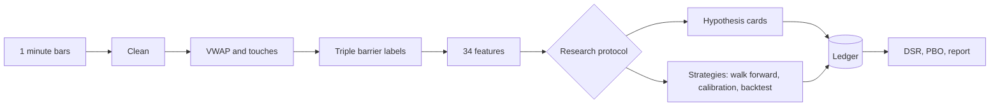
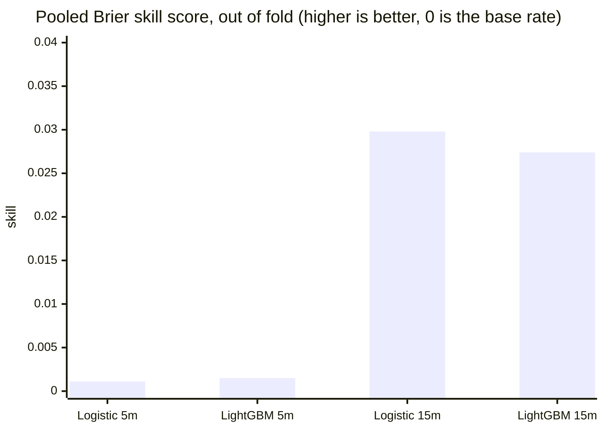
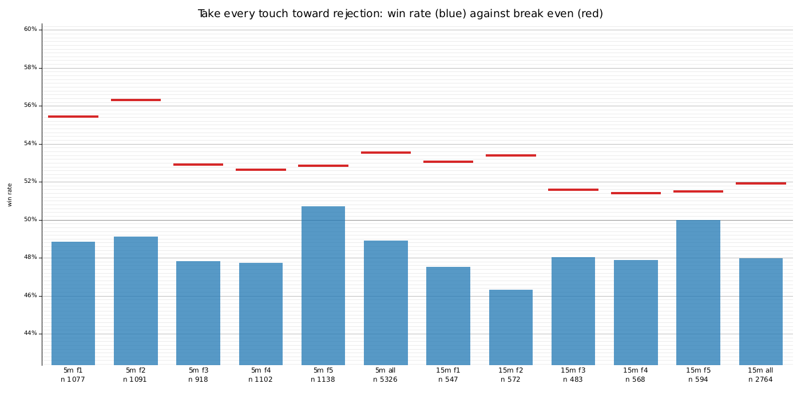
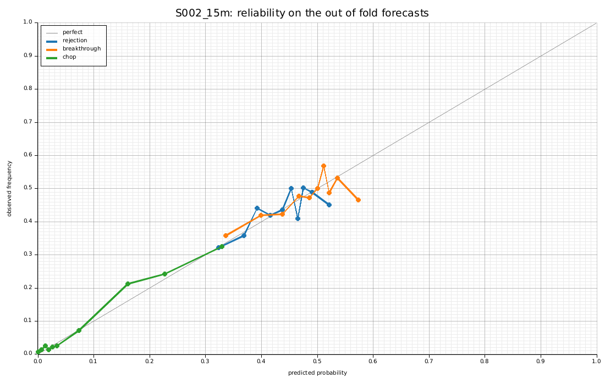
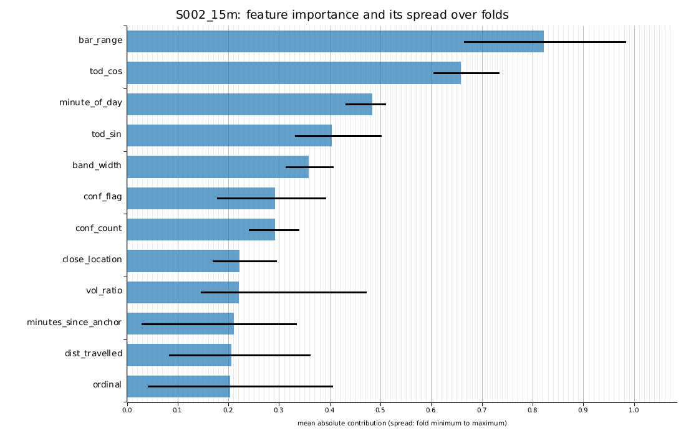
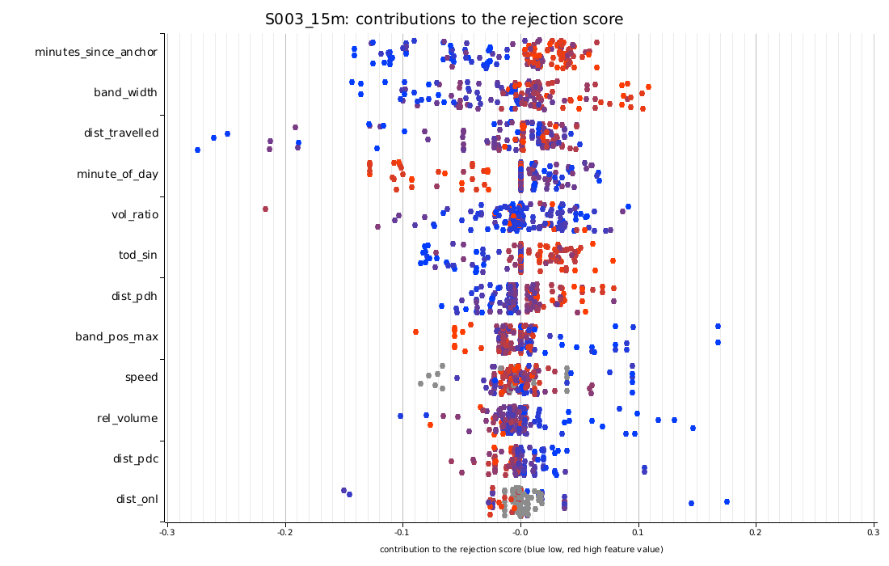
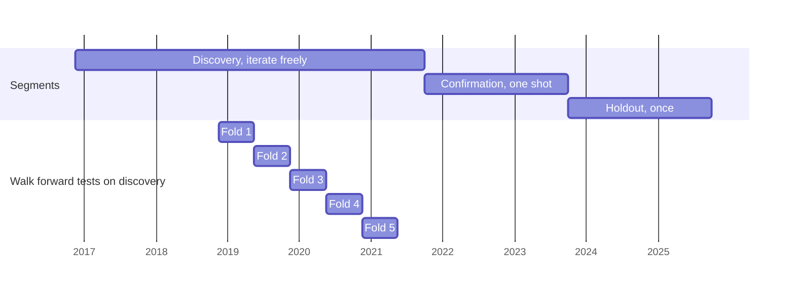

# Anchored VWAP touch study

When NQ futures touch the daily anchored VWAP on 5 or 15 minute bars, does anything known at the touch predict **rejection**, **breakthrough** or **chop**, well enough to trade after costs?

**Answer on this data: no usable directional edge.** The whole record is in git and reproduces with four commands.



## Result

| Stage | Outcome | Record |
|---|---|---|
| Gate 3a: touches vs arbitrary levels | Equivalent within about 2 points | `docs/DECISIONS.md` section 11 |
| Omnibus screen | Structure found, but only the clock driven chop rate | section 13 |
| Gate 3b: 7 hypothesis cards | None promoted (5 dropped, 2 refine) | section 14 |
| Strategies S001 to S003, 2 timeframes | Every fold abstained, 0 trades | section 16 |



**What would taking every touch have done?** Toward rejection, with barriers of plus and minus one sigma, 2.8 ticks of cost, on the same five test windows (`vwap research benchmark config`):

| Timeframe | Trades | Win rate | Needed to break even | Net per trade, ticks (95% interval) |
|---|---|---|---|---|
| 5 minute | 5,326 | 48.9% | 53.6% | `-3.41` (`-4.65` to `-2.17`) |
| 15 minute | 2,764 | 48.0% | 51.9% | `-4.78` (`-8.14` to `-1.39`) |

<p align="center">
  
</p>

A coin flip before costs, and 4 to 5 points short of break even after them, in every fold.

The 15 minute models do know something, but it is range and clock structure (chop), not direction. No threshold on the rejection probability beats the 2.8 tick round trip cost. 14 counted trials, alpha spent 0.0333 of 0.05.

<p align="center">
  
  
</p>
<p align="center">
  
</p>

Left: chop is well calibrated and separated, rejection and breakthrough hug the base rate. Right: range, time of day and band width drive the score. Below: TreeSHAP contributions (blue low, red high feature value).

## Data split



Each fold trains on the 24 months before its test window, purged and embargoed. Confirmation and holdout were never used.

## Quick start

Needs `rustup`, `cmake`, a C++ compiler with OpenMP and about 5 GB of disk. The first build takes 5 to 10 minutes.

```bash
git clone https://github.com/ObvMamut/anchored-vwap-classifier
cd anchored-vwap-classifier
cargo build --release
./target/release/vwap doctor config
./target/release/vwap pipeline config            # about 10 seconds
./target/release/vwap research verify config
./target/release/vwap research replay all config # 13 recorded runs reproduce
```

## Commands

| Task | Command |
|---|---|
| Pipeline stages | `vwap data clean`, `events detect`, `labels build`, `features build`, `baselines run`, `spotcheck` (each takes `config`) |
| Hypothesis | `vwap research register H008 config`, then `run H008`, then `confirm H008` after a PROMOTE |
| Strategy | `vwap research register S004 config`, then `strategy S004 config` |
| Overfitting check | `vwap research dsr config` |
| Report and plots | `vwap report build config` (writes `reports/`) |
| Calendar snapshot | `vwap calendar fetch config` (needs internet, features are off until committed) |
| Win rate of every touch | `vwap research benchmark config` (descriptive, no ledger entry) |
| Holdout | `vwap holdout run config` (once, needs `research/FREEZE.toml`) |

## The data

`data.parquet` holds 3,077,548 one minute bars, 15 November 2016 to 1 October 2025.

* Sorted newest first; timestamps are broker server time, converted to UTC by `config/data.toml`.
* `Volume` is all zero, so the VWAP is weighted by `TickVolume`.
* Prices are on a 0.1 grid: a broker style proxy for NQ, costed in NQ ticks.
* No roll steps are visible; 2017 to 2020 are gappy.

## Repository

| Path | Contents |
|---|---|
| `config/*.toml` | Every parameter, in typed validated structs |
| `crates/` | `vwap_core`, `vwap_data`, `vwap_events`, `vwap_labels`, `vwap_features`, `vwap_dataset`, `vwap_baselines`, `vwap_validation`, `vwap_model`, `vwap_backtest`, `vwap_calendar`, `vwap_research`, `vwap_report`, `vwap_cli`, `vwap_testkit` |
| `hypotheses/` | One TOML card per hypothesis (H) or strategy (S) |
| `research/` | Tracked, append only: ledger, card reports, strategy summaries |
| `docs/` | Specifications, decisions and results |

| Read | For |
|---|---|
| `docs/OPERATIONS.md` | Build, run, reproduce, troubleshoot |
| `docs/PROTOCOL.md` | Splits, cards, alpha budget, strategy cards |
| `docs/DECISIONS.md` | Every decision and result |
| `docs/ARCHITECTURE.md` | Crates and data flow |
| `docs/FEATURES.md`, `MODELING.md`, `VALIDATION.md`, `BACKTEST.md` | The methods |
| `CLAUDE.md` | Conventions for changing the code |

Development: `cargo test --workspace` (about 215 tests, including no lookahead property tests), `cargo clippy --workspace --all-targets --all-features -- -D warnings`, `cargo fmt --all --check`.

## Limitations

* The weight is a tick count and the series is not exchange NQ.
* Discovery is only about 4.9 years, so effects of a few points cannot be established.
* The calendar fetch has not been run against the live sites. Not built: the per trade log, breakdowns by year and regime, reliability bands, five designed features (see `docs/DECISIONS.md` section 16).
* Strategy tests use a synthetic market with a planted signal: they prove the plumbing, not anything about NQ.

## License

MIT, see `LICENSE`.
